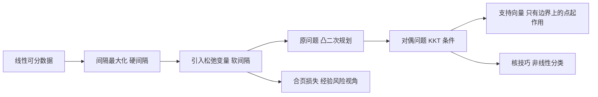

---
Title | 优化理论 约束优化与对偶 支持向量机
-- | --
Created @ | `2026-11-27T02:44:16Z`
Updated @| `2026-11-27T02:54:16Z`
Labels | ``
Edit @| [here](https://github.com/junxnone/math/issues/150)

---
# 支持向量机

支持向量机（SVM）在特征空间中找到**间隔最大**的分类超平面；它的对偶形式只依赖样本间的内积，因此可以用核函数处理非线性分类。SVM 是约束优化、对偶理论与核方法的集中体现。基础见 [约束优化与对偶](https://github.com/junxnone/math/issues/79)（含 SVM 的简要推导），核方法见 [希尔伯特空间与核方法](https://github.com/junxnone/math/issues/134)，凸性见 [凸集与凸函数](https://github.com/junxnone/math/issues/77)。

## 概念关系图

图中：从间隔最大化出发，允许少量错分得到软间隔；原问题是凸二次规划，对偶形式引出支持向量与核技巧；也可以看作「合页损失 + $L_2$ 正则」的经验风险最小化。

## 硬间隔

数据 $(x_i,y_i)$，$y_i\in\{-1,+1\}$，超平面 $w^\top x+b=0$。点到超平面的几何间隔为 $y_i(w^\top x_i+b)/\lVert w\rVert$。令最近点的函数间隔为 1，最大化间隔 $2/\lVert w\rVert$ 等价于：

$$
\min_{w,b}\ \frac12\lVert w\rVert^{2}\quad\text{s.t.}\quad y_i(w^{\top}x_i+b)\ge1,\ \ i=1,\dots,n
$$

其中：$w$ 为法向量，$b$ 为偏置；约束要求所有样本被正确分类且到超平面的函数间隔至少为 1；这是一个**凸二次规划**，有唯一解。

## 软间隔

$$
\min_{w,b,\xi}\ \frac12\lVert w\rVert^{2}+C\sum_{i}\xi_i\quad\text{s.t.}\quad y_i(w^{\top}x_i+b)\ge1-\xi_i,\ \ \xi_i\ge0
$$

其中：$\xi_i$ 是松弛变量（允许样本违反间隔）；$C>0$ 控制「间隔宽度」与「违反程度」的权衡：$C$ 大则惩罚错分严厉（间隔窄，易过拟合），$C$ 小则容忍错分（间隔宽，更平滑）。

## 对偶问题与支持向量

引入乘子 $\alpha_i\ge0$，由 KKT 条件（见 [约束优化与对偶](https://github.com/junxnone/math/issues/79)）得到对偶问题：

$$
\max_{\alpha}\ \sum_{i}\alpha_i-\frac12\sum_{i,j}\alpha_i\alpha_jy_iy_j\,x_i^{\top}x_j\quad\text{s.t.}\quad 0\le\alpha_i\le C,\ \ \sum_i\alpha_iy_i=0
$$

其中：目标只含样本间的内积 $x_i^\top x_j$；最优解满足 $w=\sum_i\alpha_iy_ix_i$。由互补松弛条件：$\alpha_i=0$ 的点在间隔之外，对 $w$ 无贡献；$\alpha_i>0$ 的点（位于间隔边界上或违反间隔）称为**支持向量**——决策边界只由它们决定，模型是稀疏的。

## 核技巧

把内积 $x_i^\top x_j$ 换成核函数 $k(x_i,x_j)=\langle\phi(x_i),\phi(x_j)\rangle$：

$$
f(x)=\operatorname{sign}\Bigl(\sum_{i}\alpha_iy_i\,k(x_i,x)+b\Bigr)
$$

其中：不显式计算特征映射 $\phi$，即可在高维（甚至无穷维）特征空间里线性分类；对应原空间里的非线性边界。常用核见 [希尔伯特空间与核方法](https://github.com/junxnone/math/issues/134)：线性核、多项式核、RBF 核。核矩阵必须半正定，见 [对称正定与二次型](https://github.com/junxnone/math/issues/41)。

## 合页损失视角

消去松弛变量，软间隔 SVM 等价于：

$$
\min_{w,b}\ \frac12\lVert w\rVert^{2}+C\sum_{i}\max\bigl(0,\ 1-y_i(w^{\top}x_i+b)\bigr)
$$

其中：$\max(0,1-z)$ 是**合页损失**（hinge loss），当样本被正确分类且间隔大于 1 时损失为 0；与逻辑回归的对数损失、0-1 损失对比见 [交叉熵与损失函数](https://github.com/junxnone/math/issues/87)。

## 与其他分类器对比

| 对比项 | SVM | 逻辑回归 |
| --- | --- | --- |
| 损失 | 合页损失（只关心边界附近） | 对数损失（利用所有样本） |
| 输出 | 类别（无概率） | 概率 |
| 稀疏性 | 解由支持向量表示 | 所有样本都参与 |
| 非线性 | 核技巧 | 需要手工特征或网络 |

表中：对比结论：小到中等规模、高维特征、需要非线性边界时 SVM 效果好；需要概率输出与大规模数据时逻辑回归更便利。

## 在机器学习中的作用

- 经典的分类与回归（SVR）；文本分类、生物信息学中的高维小样本问题
- 大规模训练用 SMO 算法或对原问题做随机梯度；核方法的代表
- 思想影响深远：间隔最大化与泛化界、表示定理

## 常见误区

- 特征尺度敏感：使用 RBF 核前应**标准化**特征，否则尺度大的特征主导距离
- $C$ 与核参数（如 RBF 的 $\gamma$）需要交叉验证选择，二者共同控制复杂度
- 核 SVM 的训练是 $O(n^2)\sim O(n^3)$，样本数很大（数十万以上）时不适用，需要近似或线性 SVM

