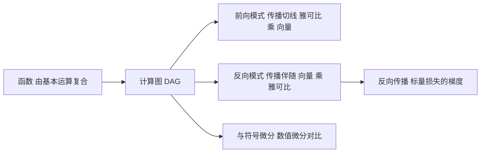

---
Title | 数值计算 数值微分与积分 自动微分
-- | --
Created @ | `2026-11-27T02:44:23Z`
Updated @| `2026-11-27T02:54:22Z`
Labels | ``
Edit @| [here](https://github.com/junxnone/math/issues/152)

---
# 自动微分

自动微分（AD）是一种**精确、高效**地计算程序所表示函数的导数的方法：把函数看作一系列基本运算组成的**计算图**，对每个基本运算应用链式法则。它既不是符号微分，也不是数值微分，而是深度学习框架（PyTorch、TensorFlow、JAX）的核心。链式法则见 [多元函数微分](https://github.com/junxnone/math/issues/54)，雅可比矩阵见 [雅可比矩阵](https://github.com/junxnone/math/issues/44)，数值微分见 [数值微分与积分](https://github.com/junxnone/math/issues/111)。

## 概念关系图

图中：函数被拆成基本运算的复合，得到计算图；前向模式沿计算方向传播导数，反向模式沿反方向传播伴随量；标量损失对大量参数求梯度时用反向模式，就是反向传播。

## 计算图与链式法则

把 $y=f(x)$ 写成中间变量序列 $v_1,v_2,\dots,v_N=y$，每一步是一个基本运算。链式法则：

$$
\frac{\partial y}{\partial x}=\frac{\partial v_N}{\partial v_{N-1}}\frac{\partial v_{N-1}}{\partial v_{N-2}}\cdots\frac{\partial v_{1}}{\partial x}
$$

其中：每个局部偏导（基本运算的导数）都是已知的简单量；整体导数是它们的**雅可比矩阵连乘**，见 [矩阵乘积](https://github.com/junxnone/math/issues/27)。AD 的两种模式就是对这个连乘选择不同的乘法顺序。

## 前向模式与反向模式

对 $f:\mathbb{R}^n\to\mathbb{R}^m$，雅可比矩阵 $J\in\mathbb{R}^{m\times n}$：

| 模式 | 计算内容 | 一次传播得到 | 适合 |
| --- | --- | --- | --- |
| 前向模式 | 雅可比 – 向量乘积 $J\mathbf{v}$（沿方向 $\mathbf{v}$ 的方向导数） | $J$ 的**一列** | 输入少、输出多（$n\ll m$） |
| 反向模式 | 向量 – 雅可比乘积 $\mathbf{u}^{\top}J$ | $J$ 的**一行** | 输入多、输出少（$m\ll n$，如 $m=1$ 的损失函数） |

表中：对比结论：神经网络是「参数极多、损失为标量」，反向模式一次反向传播就得到全部参数的梯度，代价约为一次前向的常数倍；前向模式要对每个参数各做一次。

反向模式的两遍计算：

- **前向遍**：计算并保存所有中间值 $v_i$
- **反向遍**：从输出开始，令伴随量 $\bar v_N=1$；对每个运算按相反顺序累积 $\bar v_j\mathrel{+}=\bar v_i\,\dfrac{\partial v_i}{\partial v_j}$

其中：$\bar v_i=\partial y/\partial v_i$ 称为伴随量。例如 $y=(x_1+x_2)\,x_2$，令 $a=x_1+x_2$：$\bar a=x_2$，$\bar x_1=\bar a$，$\bar x_2=\bar a+a$。矩阵形式见 [矩阵微积分](https://github.com/junxnone/math/issues/128)，全连接层的反向传播 $\bar X=\bar Y W^{\top}$ 就是向量 – 雅可比乘积。

## 与其他微分方法对比

| 方法 | 做法 | 精度 | 代价 | 问题 |
| --- | --- | --- | --- | --- |
| 符号微分 | 对表达式做符号变换 | 精确 | 表达式可能指数膨胀 | 对控制流（循环、条件）不友好 |
| 数值微分 | 有限差分 $\frac{f(x+h)-f(x)}{h}$ | 有截断与舍入误差 | 每个输入需要一次额外前向 | 步长难选，见 [误差与浮点数](https://github.com/junxnone/math/issues/107) |
| 自动微分 | 对基本运算应用链式法则 | 精确到机器精度 | 反向模式约为前向的小常数倍 | 反向模式需要保存中间值（内存） |

表中：对比结论：AD 兼具精确与高效，并且天然支持任意控制流，所以成为深度学习的标准。

## 内存与实现

- 反向模式需要保存前向的中间值，内存随网络深度增长；**梯度检查点（checkpointing）**用重算换内存
- 高阶导数：对反向模式再求导（反向的反向 / 前向套反向）得到 Hessian – 向量乘积，用于二阶优化，见 [二阶方法与拟牛顿](https://github.com/junxnone/math/issues/82)
- 实现方式：操作符重载（动态图，如 PyTorch）、源码变换（静态图，如 JAX 的 jaxpr、TensorFlow）

## 在机器学习中的作用

- 神经网络训练：自动计算损失对所有参数的梯度，见 [一阶方法与随机梯度](https://github.com/junxnone/math/issues/81)
- 可微编程：把物理仿真、渲染、优化层放入网络并端到端训练
- 隐式微分：对不动点 / 优化问题的解求导，见 [非线性方程求根](https://github.com/junxnone/math/issues/108)

## 常见误区

- 自动微分**不是**数值微分，也不是符号微分；它给出的是精确的导数值（在机器精度内），不依赖步长
- 不可导点（如 ReLU 在 0、argmax、取整）处导数需要约定；离散操作的梯度不存在，需要松弛或估计
- 反向传播的内存占用常是训练瓶颈，不只是计算量；注意中间激活的保存与重算的取舍

