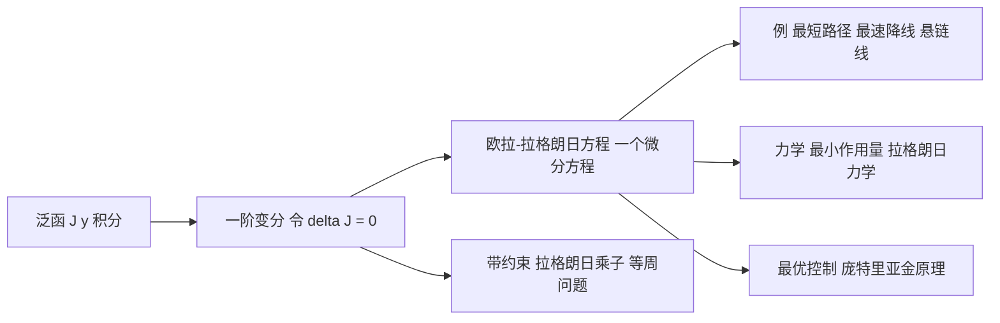

---
Title | 微积分 变分法
-- | --
Created @ | `2026-11-27T02:44:32Z`
Updated @| `2026-11-27T02:56:54Z`
Labels | ``
Edit @| [here](https://github.com/junxnone/math/issues/154)

---
# 变分法

普通微积分求**函数**的极值；变分法求**泛函**（函数的函数）的极值：在所有满足条件的函数中，找使某个积分量最小的那个函数，如最短路径、最速降线、悬链线，以及物理中的**最小作用量原理**。极值基础见 [极值与拉格朗日乘数](https://github.com/junxnone/math/issues/58)，约束见 [拉格朗日乘数法进阶](https://github.com/junxnone/math/issues/19)。

## 概念关系图

图中：对泛函令一阶变分为零，得到欧拉–拉格朗日方程；它把「泛函极值」化为「微分方程」，应用于几何、力学、最优控制；带约束的问题引入乘子。

## 泛函与变分

最简单的泛函：

$$
J[y]=\int_{a}^{b}L\bigl(x,\ y(x),\ y'(x)\bigr)\,dx,\qquad y(a)=y_a,\ y(b)=y_b
$$

其中：$y(x)$ 是待求函数；$L$ 称为拉格朗日量（被积函数）；$J$ 把每个函数映成一个数。对函数 $y$ 做微小扰动 $y+\varepsilon\eta$（$\eta(a)=\eta(b)=0$），若 $y$ 使 $J$ 取极值，则一阶变分为零：$\dfrac{d}{d\varepsilon}J[y+\varepsilon\eta]\Big|_{\varepsilon=0}=0$。

## 欧拉–拉格朗日方程

利用分部积分及 $\eta$ 的任意性，得到极值函数满足：

$$
\frac{\partial L}{\partial y}-\frac{d}{dx}\Bigl(\frac{\partial L}{\partial y'}\Bigr)=0
$$

其中：这是关于 $y(x)$ 的二阶常微分方程（见 [常微分方程](https://github.com/junxnone/math/issues/57)）；解出的函数是泛函的**驻函数**（候选极值）。若 $L$ 不显含 $x$，有首次积分（贝尔特拉米恒等式）$L-y'\dfrac{\partial L}{\partial y'}=\text{常数}$。

## 经典例子

| 问题 | 泛函 | 结果 |
| --- | --- | --- |
| 平面两点间最短路径 | $\int\sqrt{1+y'^{2}}\,dx$ | $y''=0$，直线 |
| 最速降线 | $\int\sqrt{\dfrac{1+y'^{2}}{2gy}}\,dx$ | 摆线 |
| 悬链线 | $\int y\sqrt{1+y'^{2}}\,dx$ | 双曲余弦 $y=a\cosh\dfrac{x-b}{a}$ |
| 最小作用量 | $S=\int(T-V)\,dt$ | 牛顿运动方程（拉格朗日力学） |

表中：$T$ 为动能，$V$ 为势能；对比结论：同一套方法同时解决几何与力学问题——「自然选择使作用量取极值」。

## 带约束的变分问题

在约束 $G[y]=\int g(x,y,y')\,dx=c$（如曲线长度固定）下求 $J[y]$ 的极值，引入拉格朗日乘子 $\lambda$，对 $J+\lambda G$ 应用欧拉–拉格朗日方程。经典例子：等周问题（周长固定，面积最大的曲线是圆）。

## 多变量与高阶推广

- **多个函数** $y_1,\dots,y_n$：每个函数各有一个欧拉–拉格朗日方程；多元函数 $u(x_1,\dots,x_n)$：$\dfrac{\partial L}{\partial u}-\sum_i\dfrac{\partial}{\partial x_i}\dfrac{\partial L}{\partial u_{x_i}}=0$（此时得到偏微分方程，见 [偏微分方程初步](https://github.com/junxnone/math/issues/153)）
- **高阶导数**：含 $y''$ 时方程含额外的二阶导数项
- **自然边界条件**：端点自由时，变分给出边界上的条件

## 在机器学习中的作用

- 变分推断中「在函数空间里最小化 KL」的思想：证据下界对分布（函数）的优化，见 [变分推断](https://github.com/junxnone/math/issues/146)
- 最优控制与强化学习的连续时间形式（Hamilton–Jacobi–Bellman 方程）；轨迹优化
- 图像处理：Mumford–Shah、全变分（TV）去噪等变分模型；物理信息神经网络中的能量泛函
- 最大熵原理：在约束下对分布（函数）最大化熵，见 [最大熵原理](https://github.com/junxnone/math/issues/90)

## 常见误区

- 欧拉–拉格朗日方程给出的是**驻函数**，要判断是极小、极大还是鞍点需要二阶变分（勒让德条件、雅可比条件）
- 变分的扰动 $\eta$ 必须满足边界条件（端点固定时 $\eta(a)=\eta(b)=0$），否则分部积分的边界项不消失
- 泛函极值不一定存在（可能只有下确界而无最小值）；存在性要用直接方法证明

