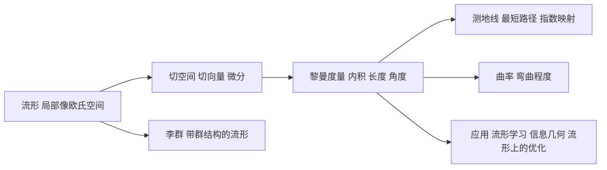

---
Title | 微积分 微分几何初步
-- | --
Created @ | `2026-11-27T02:44:40Z`
Updated @| `2026-11-27T02:57:00Z`
Labels | ``
Edit @| [here](https://github.com/junxnone/math/issues/156)

---
# 微分几何初步

微分几何用微积分研究**曲线、曲面与流形**的几何性质：长度、角度、曲率、测地线。**流形**是局部像欧氏空间、整体可以弯曲的空间；机器学习中的数据流形假设、几何深度学习、旋转群上的优化都以它为基础。基础见 [多元函数微分](https://github.com/junxnone/math/issues/54)、[雅可比矩阵](https://github.com/junxnone/math/issues/44)、[李群与李代数](https://github.com/junxnone/math/issues/135)。

## 概念关系图

图中：流形局部可用坐标描述；每点处的切空间装备内积（黎曼度量）后，就可以定义长度、角度；测地线推广直线，曲率刻画弯曲；李群是带群运算的特殊流形；这些工具用于流形学习与流形上的优化。

## 曲线与曲率

参数曲线 $\gamma(t)\in\mathbb{R}^{3}$ 的弧长与曲率：

$$
s=\int_{a}^{b}\lVert\gamma'(t)\rVert\,dt,\qquad \kappa=\frac{\lVert\gamma'\times\gamma''\rVert}{\lVert\gamma'\rVert^{3}}
$$

其中：$\lVert\gamma'\rVert$ 为速度大小，积分得到弧长；曲率 $\kappa$ 是曲线偏离直线的程度（圆的曲率为 $1/R$），叉乘见 [向量](https://github.com/junxnone/math/issues/2)。

## 曲面与第一、第二基本形式

参数曲面 $\mathbf{r}(u,v)$ 上，弧长元素由**第一基本形式**给出：

$$
ds^{2}=E\,du^{2}+2F\,du\,dv+G\,dv^{2},\qquad E=\mathbf{r}_u\!\cdot\!\mathbf{r}_u,\ F=\mathbf{r}_u\!\cdot\!\mathbf{r}_v,\ G=\mathbf{r}_v\!\cdot\!\mathbf{r}_v
$$

其中：$E,F,G$ 是切向量的内积，写成矩阵就是**度量张量** $g$；曲面的内蕴几何（长度、面积、角度）完全由它决定。**高斯曲率** $K$（两个主曲率之积）是曲面的内蕴量（高斯绝妙定理），球面 $K>0$，平面 $K=0$，马鞍面 $K<0$。

## 流形与黎曼度量

- **流形**：每点有邻域与 $\mathbb{R}^n$ 的开集同胚；用若干「坐标卡」覆盖，卡之间的转换光滑
- **切空间** $T_pM$：点 $p$ 处所有切向量构成的 $n$ 维向量空间，是流形的**局部线性化**（雅可比矩阵给出映射的切映射）
- **黎曼度量** $g_p$：每个切空间上的内积（随点光滑变化），长度 $L=\int\sqrt{g(\dot\gamma,\dot\gamma)}\,dt$

| 流形 | 维数 | 度量 | 应用 |
| --- | --- | --- | --- |
| 球面 $S^{n-1}$ | $n-1$ | 嵌入 $\mathbb{R}^n$ 的诱导度量 | 归一化嵌入、方向数据 |
| $SO(3)$ | 3 | 双不变度量 | 旋转 |
| 对称正定矩阵 | $n(n+1)/2$ | 仿射不变度量 | 协方差矩阵的比较、扩散张量 |
| 概率分布族 | 参数个数 | Fisher 信息度量 | 信息几何、自然梯度 |

表中：对比结论：许多机器学习的参数空间天然是流形，而不是平坦的欧氏空间。

## 测地线

测地线是流形上「局部最短」的曲线，推广了欧氏空间的直线。在局部坐标下满足测地线方程：

$$
\ddot{x}^{k}+\Gamma^{k}_{ij}\,\dot{x}^{i}\dot{x}^{j}=0
$$

其中：$\Gamma^k_{ij}$ 为克里斯托费尔符号，由度量及其导数计算；球面上的测地线是大圆。**指数映射**把切向量沿测地线「走」到流形上，**对数映射**是其逆；李群上的指数映射见 [李群与李代数](https://github.com/junxnone/math/issues/135)，其变分原理见 [变分法](https://github.com/junxnone/math/issues/154)。

## 在机器学习中的作用

- **流形假设**：高维数据近似分布在低维流形上；流形学习（Isomap、LLE、t-SNE、UMAP）保持局部几何
- **流形上的优化**：旋转 / 正交 / 正定约束的黎曼梯度下降，沿测地线（或回缩）更新，见 [正交矩阵](https://github.com/junxnone/math/issues/32)
- **信息几何与自然梯度**：在概率分布族上用 Fisher 信息度量，得到对参数化不敏感的更新，见 [互信息与KL散度](https://github.com/junxnone/math/issues/86)
- 几何深度学习：对球面、图、网格上的卷积与等变网络；双曲嵌入表示层次结构

## 常见误区

- 流形上的「加法」没有定义；不能直接对流形上的点相加，需要通过切空间或指数映射
- 曲率不为零的空间中，平行四边形、三角形内角和等欧氏结论不再成立；欧氏距离与测地距离不同
- 「流形」不等于「嵌入在高维空间中的曲面」：内蕴几何（由度量决定）与外在嵌入方式不同

