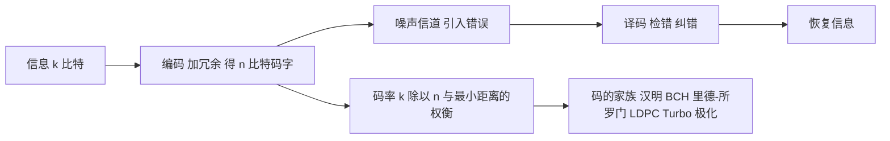

---
Title | 信息论 信道容量 纠错码
-- | --
Created @ | `2026-11-27T02:44:49Z`
Updated @| `2026-11-27T02:57:06Z`
Labels | ``
Edit @| [here](https://github.com/junxnone/math/issues/158)

---
# 纠错码

信道有噪声，传输会出错。**纠错码**在信息中加入精心设计的**冗余**，使接收端能检测并纠正错误。香农证明：只要码率低于信道容量，就存在错误率任意小的编码；纠错码研究如何构造这样的码。信道容量见 [信道容量](https://github.com/junxnone/math/issues/89)，有限域见 [代数结构](https://github.com/junxnone/math/issues/95)、[数论基础](https://github.com/junxnone/math/issues/96)。

## 概念关系图

图中：$k$ 位信息编码成 $n$ 位码字，经噪声信道后译码恢复；编码设计要在码率（效率）与最小距离（纠错能力）之间权衡；不同家族适合不同场景。

## 基本概念

$(n,k)$ **分组码**：把 $k$ 位信息映射为 $n$ 位码字（$n>k$）。

$$
\text{码率 }R=\frac{k}{n},\qquad d_{\min}=\min_{c\ne c'}d_H(c,c'),\qquad t=\Bigl\lfloor\frac{d_{\min}-1}{2}\Bigr\rfloor
$$

其中：$d_H$ 是汉明距离（两个码字不同的位数）；$d_{\min}$ 是码的**最小距离**；码能**检测** $d_{\min}-1$ 个错误、**纠正** $t$ 个错误。直观：码字在空间中彼此相距越远，越不容易被噪声混淆。

## 线性分组码

线性码的码字构成 $\mathbb{F}_2^{n}$ 的 $k$ 维子空间，可用**生成矩阵**与**校验矩阵**描述（见 [向量空间](https://github.com/junxnone/math/issues/34)）：

$$
\mathbf{c}=\mathbf{m}\,G\ \ (G\in\mathbb{F}_2^{k\times n}),\qquad H\,\mathbf{c}^{\top}=\mathbf{0},\qquad \mathbf{s}=H\mathbf{r}^{\top}\ \ (\text{伴随式})
$$

其中：$\mathbf{m}$ 为信息向量，$\mathbf{c}$ 为码字，运算在二元域 $\mathbb{F}_2$ 上（模 2）；$H$ 为校验矩阵；接收向量 $\mathbf{r}=\mathbf{c}+\mathbf{e}$（$\mathbf{e}$ 为错误向量）的**伴随式** $\mathbf{s}=H\mathbf{e}^{\top}$ 只与错误有关，据此定位错误。

## 汉明码

$(7,4)$ 汉明码：4 位信息加 3 位校验，$d_{\min}=3$，可纠正 1 位错误。校验矩阵 $H$ 的 7 列恰好是所有非零的 3 位二进制数；伴随式 $\mathbf{s}$ 直接给出出错位的位置（若 $\mathbf{s}=0$ 则无错）。码率 $4/7\approx0.57$。

## 码的家族对比

| 码 | 特点 | 应用 |
| --- | --- | --- |
| 奇偶校验 / CRC | 只检错 | 以太网、存储校验 |
| 汉明码 | 纠 1 位，简单 | 内存 ECC |
| BCH / 里德–所罗门码 | 代数构造，纠多位乃至突发错误；工作在有限域 $\mathbb{F}_{2^m}$ | CD / DVD、QR 码、卫星通信 |
| 卷积码 + Viterbi | 连续编码，用动态规划译码，见 [隐马尔可夫模型](https://github.com/junxnone/math/issues/142) | 早期移动通信 |
| Turbo 码、LDPC 码 | 逼近香农极限，迭代译码（信念传播） | 3G / 4G（Turbo）、5G / Wi-Fi（LDPC） |
| 极化码 | 首个可证明达到信道容量的构造 | 5G 控制信道 |

表中：对比结论：从简单的汉明码到逼近香农极限的 LDPC / 极化码，设计目标是在给定码率下接近信道容量。

## 与信道容量的关系

香农信道编码定理：对容量为 $C$ 的信道，码率 $R<C$ 时存在码使译码错误概率任意小；$R>C$ 则不可能。例如二元对称信道（错误概率 $p$）：

$$
C=1-H_b(p),\qquad H_b(p)=-p\log_2p-(1-p)\log_2(1-p)
$$

其中：$H_b$ 为二元熵函数，见 [熵](https://github.com/junxnone/math/issues/85)；$p=0.11$ 时 $C\approx0.5$，意味着至少需要约一半的冗余才能无差错传输。

## 在机器学习中的作用

- 机器学习系统的可靠性：存储与内存的 ECC、分布式训练中的梯度编码（容忍落后节点）
- 神经译码器与端到端通信系统：用神经网络学习编码与译码
- LDPC 译码使用的信念传播与概率图模型中的推断算法是同一类

## 常见误区

- 纠错码增加冗余，**降低**有效传输速率；检错能力与纠错能力不同（纠 $t$ 位要求 $d_{\min}\ge2t+1$，检 $s$ 位要求 $d_{\min}\ge s+1$）
- 码率越低不一定越可靠：需要同时有好的最小距离结构；随机码在大 $n$ 下接近极限，但译码复杂度极高
- 硬判决（先把信号判为 0 / 1）会损失信息；使用软判决（保留可靠度）可以明显提升性能

