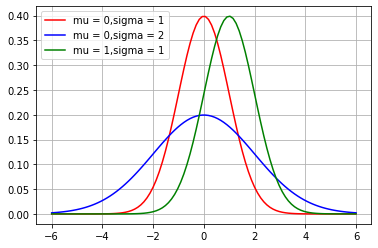
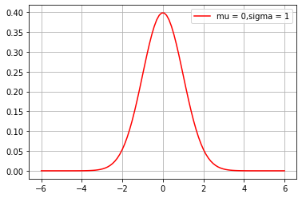
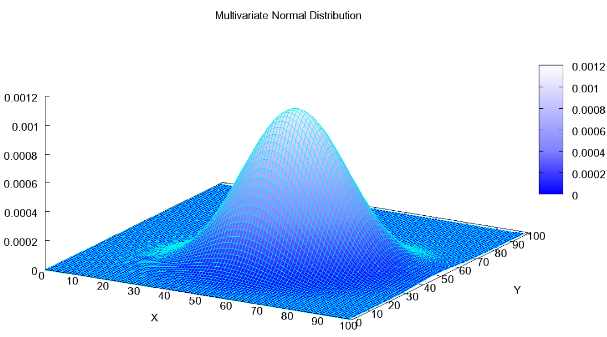
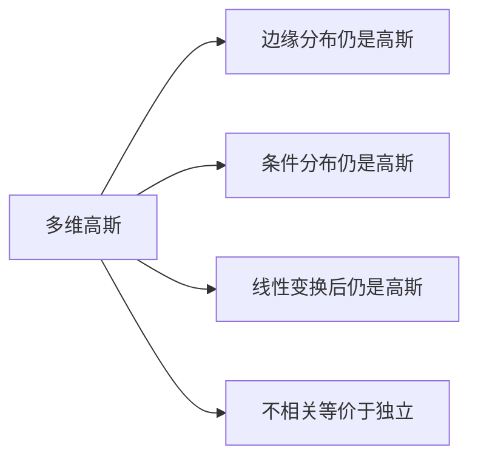

-----

| Title     | 概率论 常见分布 高斯分布进阶                                   |
| --------- | ------------------------------------------------- |
| Created @ | `2021-03-22T08:23:37Z`                            |
| Updated @ | `2026-11-27T01:41:38Z`                            |
| Labels    | \`\`                                              |
| Edit @    | [here](https://github.com/junxnone/math/issues/5) |

-----

# 高斯分布进阶

  - 高斯分布 - 正态分布 - $X\\sim\\mathcal{N}(\\mu,\\sigma^{2})$
  - $X\\sim\\mathcal{N}(0,1)$：$\\mu=0,\\ \\sigma=1$ 时为**标准正态分布**
  - 本文是 [常见分布](https://github.com/junxnone/math/issues/63)
    中高斯分布的进阶：多维高斯、条件分布与边缘分布、仿射变换、马氏距离与最大似然。

## 定义

若随机变量 $X$ 的概率密度函数为

$$
f(x)=\\frac{1}{\\sqrt{2\\pi},\\sigma}\\exp\!\\Bigl(-\\frac{(x-\\mu)^{2}}{2\\sigma^{2}}\\Bigr)
$$

则称 $X$ 服从正态分布，记作 $X\\sim\\mathcal{N}(\\mu,\\sigma^2)$。

其中：

  - $\\mu$：均值（位置参数），决定曲线的中心；$\\sigma\>0$：标准差（尺度参数），决定曲线的宽窄；$\\sigma^2$
    为方差
  - $\\dfrac{1}{\\sqrt{2\\pi}\\sigma}$：归一化常数，保证密度曲线下总面积为 1
  - 曲线关于 $x=\\mu$ 对称，$\\mu$ 同时是均值、中位数和众数

标准化：若 $X\\sim\\mathcal{N}(\\mu,\\sigma^2)$，则
$Z=\\dfrac{X-\\mu}{\\sigma}\\sim\\mathcal{N}(0,1)$。

**$3\\sigma$ 规则**：$P(\\lvert
X-\\mu\\rvert\<\\sigma)\\approx68.3%$，$P(\\lvert
X-\\mu\\rvert\<2\\sigma)\\approx95.4%$，$P(\\lvert
X-\\mu\\rvert\<3\\sigma)\\approx99.7%$。

## 一维与多维高斯分布

| 分布     | 概率密度函数                                                                                                                                                                                                                                                             | 曲线                                                           |
| ------ | ------------------------------------------------------------------------------------------------------------------------------------------------------------------------------------------------------------------------------------------------------------------ | ------------------------------------------------------------ |
| 一维正态分布 | $f(x)=\\dfrac{1}{\\sqrt{2\\pi}\\sigma}e^{-\\frac{(x-\\mu)^2}{2\\sigma^2}}$                                                                                                                                                                                         |  |
| 标准正态分布 | $\\varphi(x)=\\dfrac{1}{\\sqrt{2\\pi}}e^{-x^2/2}$                                                                                                                                                                                                                  |  |
| 二维高斯分布 | $f(x,y)=\\dfrac{1}{2\\pi\\sigma\_x\\sigma\_y\\sqrt{1-\\rho^2}}\\exp\!\\Bigl{-\\dfrac{1}{2(1-\\rho^2)}\\Bigl\[\\dfrac{(x-\\mu\_x)^2}{\\sigma\_x^2}-\\dfrac{2\\rho(x-\\mu\_x)(y-\\mu\_y)}{\\sigma\_x\\sigma\_y}+\\dfrac{(y-\\mu\_y)^2}{\\sigma\_y^2}\\Bigr\]\\Bigr}$ |  |
| 多维高斯分布 | 见下节                                                                                                                                                                                                                                                                | （无）                                                          |

表中：

  - 前两行的曲线分别是一维钟形曲线和标准正态曲线；$\\rho$ 为二维情形的相关系数，$\\rho=0$ 时两个坐标独立
  - 对比结论：一维用 $(\\mu,\\sigma^2)$ 描述，多维用（均值向量，协方差矩阵）描述

## 多维高斯分布

$$
f(\\mathbf{x})=\\frac{1}{(2\\pi)^{d/2}\\lvert\\Sigma\\rvert^{1/2}}\\exp\!\\Bigl(-\\frac12(\\mathbf{x}-\\boldsymbol\\mu)^{\\top}\\Sigma^{-1}(\\mathbf{x}-\\boldsymbol\\mu)\\Bigr)
$$

其中：

  - $\\mathbf{x}\\in\\mathbb{R}^{d}$：$d$
    维随机向量；$\\boldsymbol\\mu\\in\\mathbb{R}^{d}$：均值向量
  - $\\Sigma\\in\\mathbb{R}^{d\\times
    d}$：协方差矩阵，对称正定；$\\lvert\\Sigma\\rvert$
    为其行列式；$\\Sigma^{-1}$ 称为精度矩阵
  - 指数部分
    $(\\mathbf{x}-\\boldsymbol\\mu)^\\top\\Sigma^{-1}(\\mathbf{x}-\\boldsymbol\\mu)$
    是**马氏距离**的平方：考虑了各维度的尺度与相关性的距离
  - $d=1$ 时退化为一维公式（$\\Sigma=\\sigma^2$）

### 等高线的几何形状

密度相等的点满足
$(\\mathbf{x}-\\boldsymbol\\mu)^\\top\\Sigma^{-1}(\\mathbf{x}-\\boldsymbol\\mu)=c$，这是一个**椭球**：

  - 椭球的中心是 $\\boldsymbol\\mu$
  - 对 $\\Sigma$ 做特征分解 $\\Sigma=Q\\Lambda Q^\\top$：特征向量（$Q$
    的列）给出椭球的**主轴方向**，特征值 $\\lambda\_i$
    给出沿主轴的方差，半轴长为 $\\sqrt{c\\lambda\_i}$
  - $\\Sigma$ 为对角矩阵：主轴与坐标轴对齐；$\\Sigma=\\sigma^2I$：各向同性，等高线是圆（球）

详见
[特征值与特征向量](https://github.com/junxnone/math/issues/36)、[对称正定与二次型](https://github.com/junxnone/math/issues/41)。

## 重要性质

图中：多维高斯在边缘化、条件化、线性变换下**封闭**，这是它在数学上方便的根本原因。

### 线性（仿射）变换

若 $\\mathbf{x}\\sim\\mathcal{N}(\\boldsymbol\\mu,\\Sigma)$，$A$
为矩阵，$\\mathbf{b}$ 为向量，则

$$
A\\mathbf{x}+\\mathbf{b}\\sim\\mathcal{N}\\bigl(A\\boldsymbol\\mu+\\mathbf{b},\\
A\\Sigma A^{\\top}\\bigr) $$

其中：均值按同样的变换变化，协方差变为 $A\\Sigma A^\\top$。特例：独立高斯之和仍是高斯，均值与方差分别相加。

### 边缘分布与条件分布

把 $\\mathbf{x}$ 分块为
$\\begin{bmatrix}\\mathbf{x}\_a\\\\mathbf{x}\_b\\end{bmatrix}$，均值与协方差相应分块：

$$
\\boldsymbol\\mu=\\begin{bmatrix}\\boldsymbol\\mu\_a\\\\boldsymbol\\mu\_b\\end{bmatrix},\\qquad
\\Sigma=\\begin{bmatrix}\\Sigma\_{aa}&\\Sigma\_{ab}\\\\Sigma\_{ba}&\\Sigma\_{bb}\\end{bmatrix}
$$

则

$$
\\mathbf{x}*a\\sim\\mathcal{N}(\\boldsymbol\\mu\_a,\\Sigma*{aa}),\\qquad
\\mathbf{x}*a\\mid\\mathbf{x}*b\\sim\\mathcal{N}\\Bigl(\\boldsymbol\\mu\_a+\\Sigma*{ab}\\Sigma*{bb}^{-1}(\\mathbf{x}*b-\\boldsymbol\\mu\_b),\\
\\Sigma*{aa}-\\Sigma\_{ab}\\Sigma\_{bb}^{-1}\\Sigma\_{ba}\\Bigr) $$

其中：

  - 边缘分布直接取对应的子块
  - 条件均值是在 $\\mathbf{x}*b$ 的观测值上做**线性修正**，修正量由两块之间的相关性 $\\Sigma*{ab}$ 决定
  - 条件协方差 $\\Sigma\_{aa}-\\Sigma\_{ab}\\Sigma\_{bb}^{-1}\\Sigma\_{ba}$ 是
    $\\Sigma\_{bb}$ 的 **Schur 补**；观测 $\\mathbf{x}\_b$
    只会使不确定性减小，且与具体观测值无关
  - 这是高斯过程回归（见
    [高斯过程进阶](https://github.com/junxnone/math/issues/20)）、卡尔曼滤波的数学基础

### 不相关与独立

对**联合高斯**的变量，协方差为 0（不相关）等价于相互独立；对一般分布这个等价不成立，见
[多维随机变量与协方差](https://github.com/junxnone/math/issues/65)。

## 参数估计

给定独立同分布样本 $\\mathbf{x}\_1,\\dots,\\mathbf{x}\_n$，最大似然估计为：

$$ \\hat{\\boldsymbol\\mu}=\\frac1n\\sum\_{i=1}^{n}\\mathbf{x}*i,\\qquad
\\hat\\Sigma=\\frac1n\\sum*{i=1}^{n}(\\mathbf{x}\_i-\\hat{\\boldsymbol\\mu})(\\mathbf{x}\_i-\\hat{\\boldsymbol\\mu})^{\\top}
$$

其中：$\\hat{\\boldsymbol\\mu}$ 为样本均值，$\\hat\\Sigma$ 为样本协方差（用 $\\frac1n$
时是有偏的最大似然估计，无偏估计用 $\\frac1{n-1}$）。详见
[点估计](https://github.com/junxnone/math/issues/70)。

## 为什么高斯分布无处不在

  - **中心极限定理**：大量独立随机因素的叠加近似服从高斯分布，见
    [大数定律与中心极限定理](https://github.com/junxnone/math/issues/66)
  - **最大熵**：在给定均值和方差的所有分布中，高斯分布的熵最大，即「做了最少的额外假设」，见
    [最大熵原理](https://github.com/junxnone/math/issues/90)
  - **解析性质好**：封闭性使推导可以得到闭式解

## 在机器学习中的作用

  - 噪声模型：线性回归假设误差服从高斯分布，对应最小二乘，见
    [最小二乘进阶](https://github.com/junxnone/math/issues/6)
  - 高斯混合模型（GMM）与 EM 聚类；高斯过程；变分自编码器中的高斯先验与后验
  - 白化：用 $\\Sigma^{-1/2}$ 变换使协方差变成单位阵
  - 马氏距离用于异常检测

## 常见误区

  - 高斯分布的密度值可以大于 1（它是密度，不是概率）；概率是曲线下面积
  - 边缘分布都是高斯，不能推出联合分布是高斯
  - 协方差矩阵必须对称正定；估计时样本数小于维数会使 $\\hat\\Sigma$ 奇异，需要正则化

## Reference

  - [多元高斯分布（The Multivariate normal
    distribution）](https://www.cnblogs.com/bingjianing/p/9117330.html)
