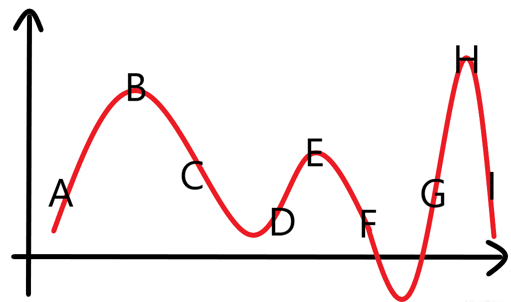
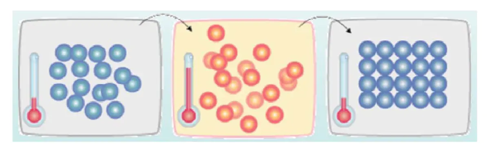
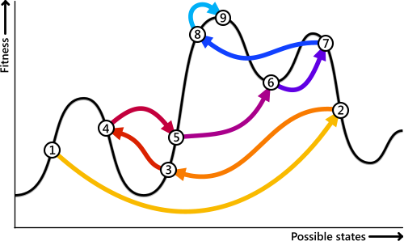
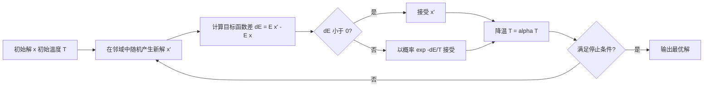

-----

| Title     | 优化理论 非凸优化 模拟退火进阶                                   |
| --------- | -------------------------------------------------- |
| Created @ | `2021-03-30T08:34:59Z`                             |
| Updated @ | `2026-11-27T01:41:51Z`                             |
| Labels    | \`\`                                               |
| Edit @    | [here](https://github.com/junxnone/math/issues/14) |

-----

# 模拟退火进阶

  - SA - Simulated annealing - 来源于固体退火原理
  - `Hill Climbing` + `Random Walk`
  - 搜索过程中以一定概率接受比当前解较差的解，以跳出局部最优，概率随着时间推移逐渐降低
  - 本文是 [非凸优化](https://github.com/junxnone/math/issues/83)
    中全局优化方法的进阶：Metropolis 准则、降温策略、收敛性与参数选择。

## Hill climbing

  - 爬山算法是一种简单的贪心搜索算法，该算法每次从当前解的临近解空间中选择一个最优解作为当前解，直到达到一个局部最优解
  - 如图， 有局部最优解 B/E, 如果初始点在 A - G之前的谷底，则只可能达到局部最优点 B/E

图中：横轴是解空间，纵轴是目标函数值；图中有多个局部最优点，贪心的爬山算法一旦爬到某个山峰（谷底）就无法再下来，所以结果取决于初始点。

## Simulated Annealing

| 自然界退火 |  |
| ----- | ------------------------------------------------------------ |

> 将固体加温至充分高，再让其徐徐冷却（退火），加温时，固体内部粒子随温升变为无序状，内能增大，而徐徐冷却时粒子渐趋有序，在每个温度都达到平衡态，最后在常温时达到基态，内能减为最小

图中：以上各图为原文档附带的退火过程与搜索过程示意；类比关系是：「内能」对应目标函数值，「粒子状态」对应解，「温度」控制接受变差的概率。

## 算法流程

图中：每步随机取一个邻域解；变好（能量下降）则一定接受，变差则以一定概率接受；然后降低温度，循环到终止。

## Metropolis 接受准则

对最小化问题，设当前解能量为 $E(x)$，候选解为 $x'$：

$$ P(\\text{接受 }x')=\\begin{cases}1 & \\Delta E=E(x')-E(x)\\le0\\
\\exp\!\\bigl(-\\Delta E/T\\bigr) & \\Delta E\>0\\end{cases} $$

其中：

  - $E(x)$：目标函数（「能量」）；$\\Delta E$：候选解比当前解变差的量
  - $T\>0$：温度参数。$T$ 大时 $\\exp(-\\Delta E/T)\\approx1$，几乎接受任何解（随机游走）；$T$
    小时变差的解几乎不被接受（退化为爬山）
  - 在固定温度下，这个接受规则使得当前解的分布趋于**玻尔兹曼分布**：

$$ P\_T(x)\\propto\\exp\!\\bigl(-E(x)/T\\bigr) $$

其中：能量越低的解概率越大；$T\\to0$ 时分布集中到全局最优解。这是模拟退火的理论基础，也是
MCMC（Metropolis–Hastings）算法的特例，见
[马尔可夫过程进阶](https://github.com/junxnone/math/issues/18)
的细致平衡。

## 降温策略

| 策略   | 公式                                               | 特点                      |
| ---- | ------------------------------------------------ | ----------------------- |
| 指数降温 | $T\_{k+1}=\\alpha T\_k,\\ \\alpha\\in(0.8,0.99)$ | 最常用，简单                  |
| 线性降温 | $T\_k=T\_0-k,\\delta$                            | 简单，末期可能降得过快             |
| 对数降温 | $T\_k=\\dfrac{c}{\\ln(1+k)}$                     | 理论上能保证以概率 1 收敛到全局最优，但极慢 |
| 快速降温 | $T\_k=\\dfrac{T\_0}{1+k}$                        | 比对数快，适合某些问题             |

表中：

  - $T\_0$ 为初始温度；$k$ 为迭代轮数；$\\alpha$ 为降温系数
  - 对比结论：实践中多用指数降温；理论保证与计算时间之间需要折中

## 参数选择

  - **初始温度** $T\_0$：应使初始接受率较高（如 80% 以上），可以按「典型的 $\\Delta E$ 除以
    $\\ln(1/\\text{初始接受率})$」估计
  - **每个温度下的迭代次数**：使系统在该温度下基本达到平衡
  - **终止条件**：温度降到阈值、连续多轮没有改进，或达到最大迭代次数
  - **邻域定义**：邻域太小搜索太慢，太大接近随机搜索；组合问题中常用交换、翻转、插入等操作

## 与其他方法对比

| 方法   | 机制           | 特点                                                                      |
| ---- | ------------ | ----------------------------------------------------------------------- |
| 爬山   | 只接受更优解       | 快，易陷入局部最优                                                               |
| 模拟退火 | 以温度控制概率接受更差解 | 能跳出局部最优，无需梯度                                                            |
| 遗传算法 | 种群 + 交叉变异选择  | 并行搜索，参数较多                                                               |
| 梯度下降 | 沿负梯度         | 需要可导，适合连续光滑问题，见 [一阶方法与随机梯度](https://github.com/junxnone/math/issues/81) |

表中：对比结论：模拟退火适合离散、组合优化和不可导的目标函数（如 TSP、排课、布局），代价是收敛慢、需要调参。

## 在机器学习中的作用

  - 组合优化：旅行商（TSP）、特征选择、神经网络结构搜索的启发式
  - 采样：以退火方式改进 MCMC（并行回火、退火重要性采样）
  - 随机梯度下降中的「学习率衰减 / 噪声退火」可看作类似思想，见
    [非凸优化](https://github.com/junxnone/math/issues/83)

## 常见误区

  - 降温不能太快：快速降温（淬火）会冻结在局部最优
  - 温度的数值没有普适意义，取决于 $\\Delta E$ 的尺度，要根据目标函数调整
  - 只有以足够慢的速度降温才有全局收敛保证，实际使用是「找到足够好的解」

## UseCase

  - 数独、路径规划等问题的可视化演示见下方 Reference

## Reference

  - [模拟退火算法](https://ustccoder.github.io/2019/05/20/optimization_SA/)
  - [模拟退火算法 Simulated Annealing](https://www.jianshu.com/p/57678cfe8553)
  - [SA - 数独-
    Visualizer](https://jeremypflipsen.github.io/Sudoku-Visualizer/#0)
  - [SA -
    demo](http://aimacode.github.io/aima-javascript/4-Beyond-Classical-Search/)
  - [SA - 路径规划
    demo](https://harmonc.github.io/sketches/simulated_annealing/index.html)
