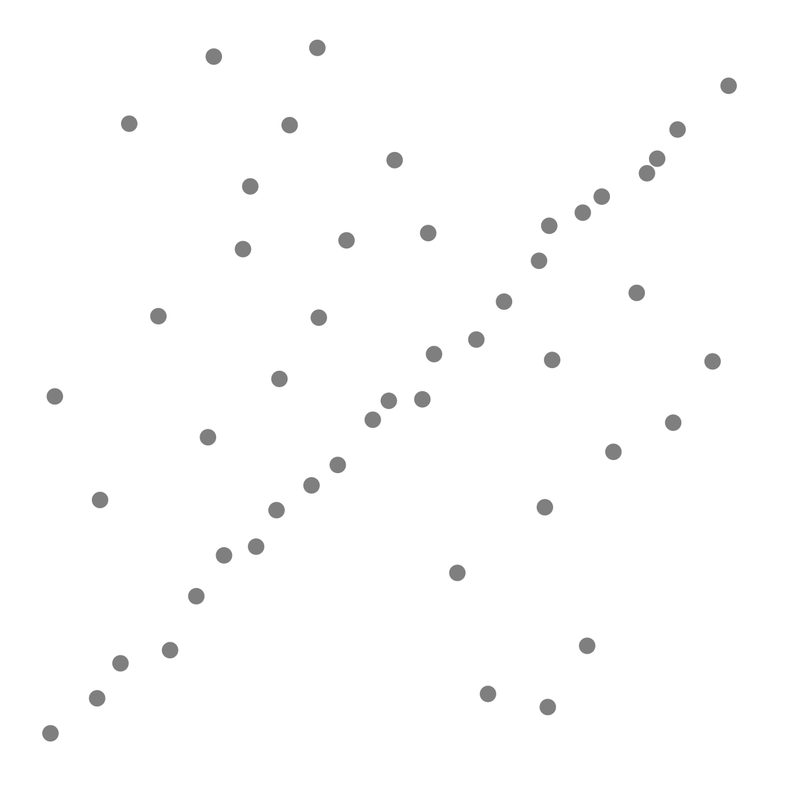
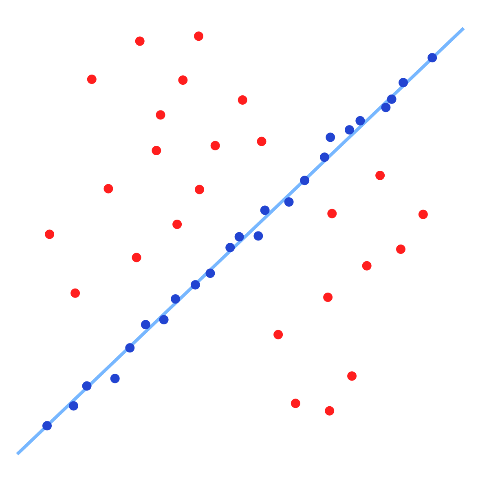
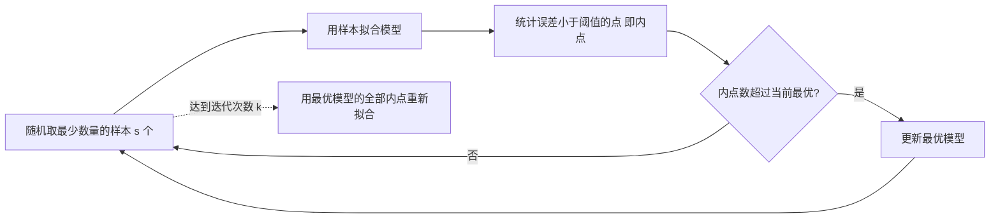

-----

| Title     | 数值计算 插值与拟合 RANSAC进阶                                |
| --------- | -------------------------------------------------- |
| Created @ | `2022-03-07T02:43:11Z`                             |
| Updated @ | `2026-11-27T01:41:54Z`                             |
| Labels    | \`\`                                               |
| Edit @    | [here](https://github.com/junxnone/math/issues/15) |

-----

# RANSAC进阶

  - RANSAC - `RANdom SAmple Consensus` - 随机抽样一致
  - 假设：数据由正常数据(inliers)和噪声(outliers)组成
      - **随机性** 根据正确数据出现概率随机选取抽样数据
      - **假设性** 假设选取的数据都是正确数据
  - **应用** 直线拟合/平面拟合/图像点云配准
  - 本文是 [插值与拟合](https://github.com/junxnone/math/issues/110)
    中最小二乘拟合的进阶：当数据含有大量离群点时，最小二乘（见
    [最小二乘进阶](https://github.com/junxnone/math/issues/6)）会被拉偏，RANSAC
    通过「随机采样 + 一致性投票」得到鲁棒的拟合。

## 直线拟合

| 带噪声的数据                                                       | RANSAC 拟合                                                    |
| ------------------------------------------------------------ | ------------------------------------------------------------ |
|  |  |

表中：左图是带离群点的数据，右图是 RANSAC 拟合出的直线，离群点没有影响最终结果。

### Steps

  - 随机采样两个点
  - 拟合模型
  - 计算 Score

| Steps      | Figure                                                                                                                       |
| ---------- | ---------------------------------------------------------------------------------------------------------------------------- |
| ① Sample   |  |
| ② Solve    |  |
| ③ Score    |  |
| Repeat ①②③ |  |
| demo       |  |

表中：依次是采样、求解、打分三步和重复迭代的过程示意，最后一行为动态演示。

## 算法

图中：反复随机采样、拟合、统计内点，保留内点最多的模型，最后用其全部内点做一次最小二乘精修。

模型的内点判定：

$$ \\text{inlier}(p\_i)\\iff d(p\_i,\\mathcal{M})\<\\tau $$

其中：$p\_i$ 为第 $i$ 个数据点；$\\mathcal{M}$ 为当前模型（直线、平面、变换等）；$d(\\cdot,\\cdot)$
为点到模型的距离（残差）；$\\tau$ 为内点阈值。

## 迭代次数

希望以概率 $p$（如 0.99）至少有一次采样**全部是内点**，所需迭代次数：

$$ k=\\frac{\\ln(1-p)}{\\ln\\bigl(1-w^{s}\\bigr)} $$

其中：

  - $w$：数据中内点所占的比例；$s$：拟合模型所需的**最少样本数**（直线 $s=2$，平面 $s=3$，单应矩阵 $s=4$）
  - $w^{s}$：一次采样全是内点的概率；$1-w^s$：一次采样失败的概率
  - 例：$w=0.5,\\ s=2,\\
    p=0.99$：$k=\\dfrac{\\ln0.01}{\\ln0.75}\\approx16$；$s=4$ 时
    $w^s=0.0625$，$k\\approx72$
  - 离群点比例越大、模型越复杂，需要的迭代次数增长越快

## 与最小二乘对比

| 对比项   | 最小二乘   | RANSAC              |
| ----- | ------ | ------------------- |
| 利用的数据 | 全部点    | 只用内点（由投票决定）         |
| 对离群点  | 敏感，被拉偏 | 鲁棒，可容忍高比例离群点        |
| 结果    | 确定，闭式解 | 随机，每次可能略有不同         |
| 参数    | 无      | 阈值 $\\tau$、迭代次数 $k$ |
| 计算量   | 一次求解   | 多次采样，随离群率增大         |

表中：对比结论：数据干净用最小二乘；有显著离群点（如特征匹配、点云配准）用 RANSAC，并用内点做最小二乘精修。

## 变体

| 变体        | 改进                   |
| --------- | -------------------- |
| MSAC      | 用截断的残差损失评分，而不只是数内点个数 |
| PROSAC    | 先从质量高的样本中采样，更快收敛     |
| LO-RANSAC | 找到较好的模型后立即做局部优化      |
| MLESAC    | 用最大似然评分模型            |

表中：对比结论：这些变体都围绕「评分更准、采样更快」改进；PCL 中对应的实现见 aiwiki 的
[SAC](https://github.com/junxnone/aiwiki/issues/314)。

## 在机器学习与视觉中的作用

  - 图像特征匹配后估计单应矩阵、基础矩阵，剔除误匹配
  - 点云中提取平面、圆柱（地面分割）、点云配准的粗对齐
  - 鲁棒回归：作为对 [回归分析](https://github.com/junxnone/math/issues/73) 的离群点处理手段

## 常见误区

  - 阈值 $\\tau$ 要与数据噪声的尺度匹配：过小丢掉真内点，过大把离群点算进去
  - 内点比例未知时，迭代次数需要自适应更新（随当前最好的内点比例调整 $k$）
  - RANSAC 只能保证「以高概率」找到解，不保证全局最优；多个模型共存时需要逐个提取

## Reference

  - [Random Sample consensus](http://www.ai.sri.com/pubs/files/836.pdf)
  - [demo](http://www.visual-experiments.com/demo/ransac.js/)
