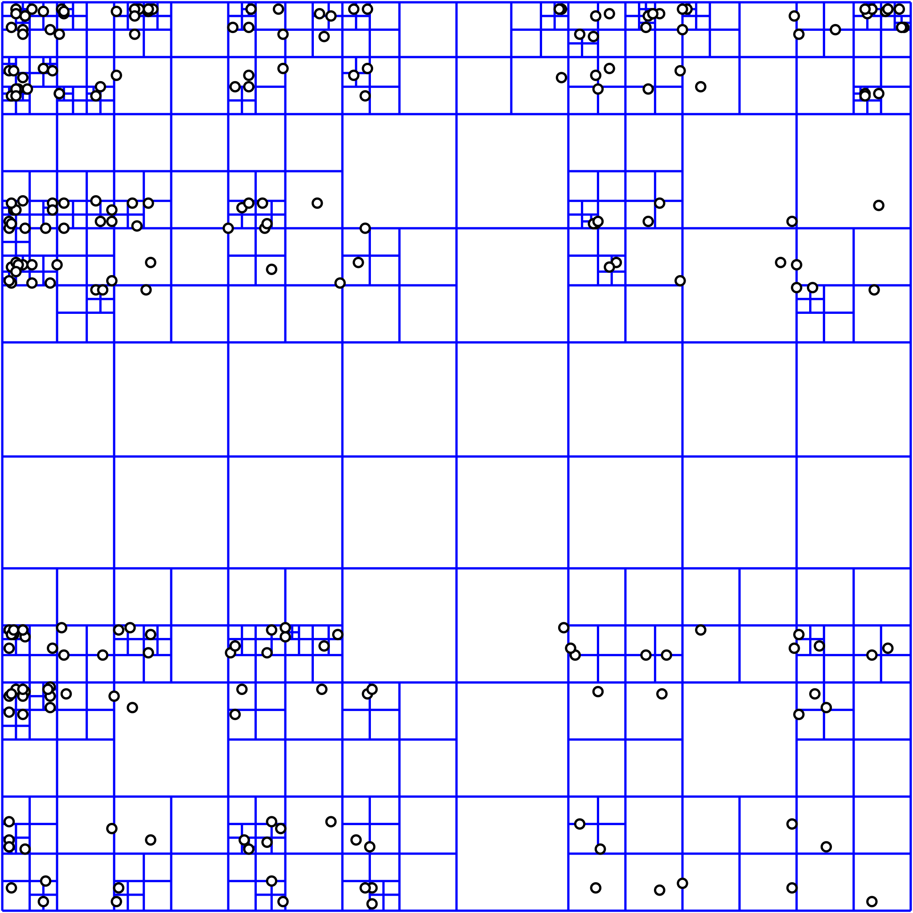
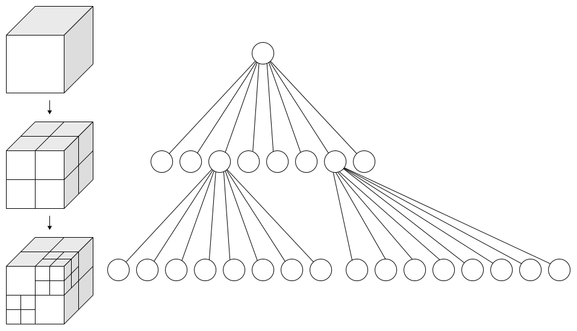
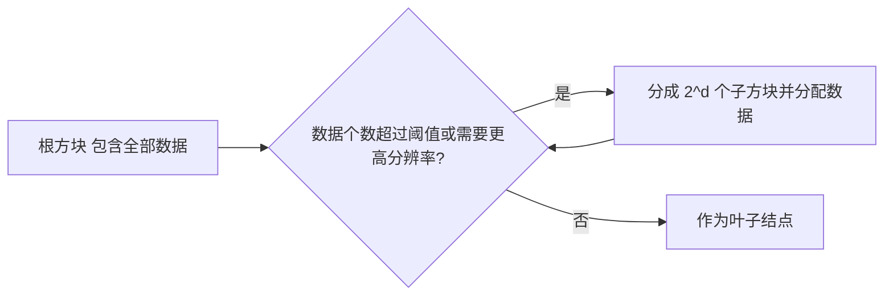

-----

| Title     | 图论 树 四叉树与八叉树进阶                                     |
| --------- | -------------------------------------------------- |
| Created @ | `2021-08-19T06:15:39Z`                             |
| Updated @ | `2026-11-27T01:41:58Z`                             |
| Labels    | \`\`                                               |
| Edit @    | [here](https://github.com/junxnone/math/issues/17) |

-----

# 四叉树与八叉树进阶

  - QuadTree - 四叉树：把二维空间递归地分成四个象限
  - OcTree - `oct + tree` 八叉树：把三维空间递归地分成八个卦限
  - 本文是 [树](https://github.com/junxnone/math/issues/117)
    的进阶：作为**空间划分树**，在空间中做快速查询、压缩与碰撞检测。

| Name     | Dimensional |
| -------- | ----------- |
| QuadTree | 2D          |
| OcTree   | 3D          |

| QuadTree                                                     | OcTree                                                       |
| ------------------------------------------------------------ | ------------------------------------------------------------ |
|  |  |

表中：左图是四叉树对二维平面的划分，右图是八叉树对三维空间的划分；每个方块（结点）被继续分成 4 个（2D）或 8 个（3D）子方块。

## 结构

  - 每个结点对应空间中的一个轴对齐的方块（二维为正方形，三维为立方体）
  - 一个结点有 $2^{d}$ 个孩子：$d=2$ 时是 4 个，$d=3$ 时是 8 个
  - 叶子结点存放落在该方块中的数据（点、物体或「占用 / 空闲」标记）

$$ \\text{子结点数}=2^{d},\\qquad \\text{深度 }h\\text{
的完全树分辨率}=\\frac{L}{2^{h}} $$

其中：$d$ 为空间维数；$L$ 为根方块的边长；$h$ 为树的深度，第 $h$ 层方块的边长为 $L/2^{h}$。深度每增加
1，分辨率提高一倍。

## 构建与查询

图中：从根开始，只要某个方块内的数据过多（或精度不够），就把它等分成子方块，递归到满足条件为止。

  - **点查询**：每次比较点相对于方块中心在各维的位置，决定进入哪个子结点，复杂度 $O(h)$
  - **范围查询**：只访问与查询范围相交的方块，其余整块跳过
  - **最近邻搜索**：先搜索包含查询点的叶子，再回溯检查相邻方块

## 两类应用

### 点区域四叉树（Point QuadTree / PR QuadTree）

存放点集：一个方块内点数超过容量就分裂；用于二维点的范围检索、最近邻。

### 区域四叉树（Region QuadTree）与八叉树地图

对二值图像或占用栅格：若一个方块内所有像素相同就作为叶子，否则分裂。均匀区域用一个大结点存储，因此能**压缩**图像和三维占用图：

$$ \\text{结点数}\\ \\lesssim\\ O(\\text{边界长度或表面积}) $$

其中：结点数主要集中在物体边界处，而不是整个体积；所以八叉树地图（如机器人使用的 OctoMap）比均匀三维栅格节省大量内存。

## 与其他空间结构对比

| 结构         | 划分方式            | 特点                                                                     |
| ---------- | --------------- | ---------------------------------------------------------------------- |
| 四叉树 / 八叉树  | 按固定位置（中心）等分空间   | 结构简单，分辨率分层，适合栅格与占用图                                                    |
| KD 树       | 按数据在某一维的中位数交替分割 | 自适应数据分布，适合近邻搜索，见 [近邻搜索](https://github.com/junxnone/aiwiki/issues/102) |
| BVH（包围体层次） | 按物体的包围盒分组       | 适合光线追踪与碰撞检测                                                            |
| BSP 树      | 用任意平面递归分割       | 适合场景渲染与可见性判断                                                           |
| 均匀栅格       | 固定大小的格子         | 查询 $O(1)$，但内存随体积增长                                                     |

表中：对比结论：数据分布均匀、需要分辨率分层用八叉树；数据分布不均、做近邻搜索用 KD 树。

## 在机器学习与工程中的作用

  - 点云处理：下采样、邻域搜索、三维重建，见 aiwiki 的
    [PCL](https://github.com/junxnone/aiwiki/issues/77)
  - 机器人建图：OctoMap 用八叉树存储三维占用概率
  - 图像压缩与多分辨率表示；游戏与物理引擎中的碰撞检测
  - 神经渲染中的稀疏体素结构

## 常见误区

  - 四叉树 / 八叉树按**空间位置**等分，与数据本身的分布无关；数据严重聚集时树会很深
  - 深度太大时内存和查询代价上升，需要设置最大深度或最小方块
  - 边界上的点需要明确归属哪个子方块的规则，否则会出现重复或遗漏

## Reference

  - [Octree](https://en.wikipedia.org/wiki/Octree)
  - [Quadtree](https://en.wikipedia.org/wiki/Quadtree)
  - [空间数据结构(四叉树/八叉树/BVH树/BSP树/k-d树)](https://www.cnblogs.com/KillerAery/p/10878367.html)
  - [KdTree && Octree
    原理学习对比以及可视化分析--"索引树"](https://www.cnblogs.com/ZuDame/p/11193179.html)
