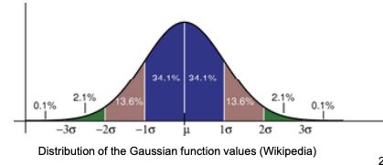
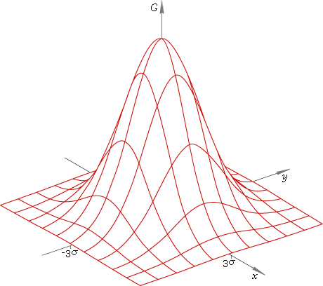
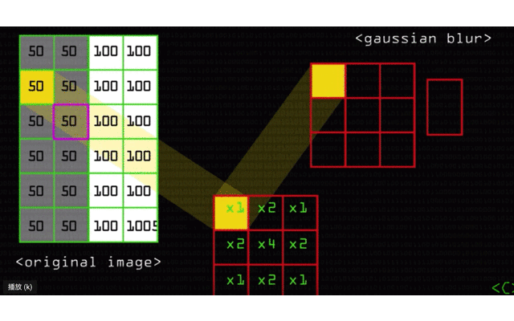

-----

| Title     | 信号与傅里叶变换 滤波器 高斯滤波器进阶                               |
| --------- | -------------------------------------------------- |
| Created @ | `2020-09-17T09:05:39Z`                             |
| Updated @ | `2026-11-27T01:42:06Z`                             |
| Labels    | \`\`                                               |
| Edit @    | [here](https://github.com/junxnone/math/issues/21) |

-----

# 高斯滤波器进阶

  - 用高斯函数对 image 做卷积计算
  - 本文是 [滤波器](https://github.com/junxnone/math/issues/104) 与
    [卷积](https://github.com/junxnone/math/issues/100)
    的进阶：高斯核的定义、频域特性、可分离性、尺度空间，以及与高斯分布的联系（见
    [高斯分布进阶](https://github.com/junxnone/math/issues/5)）。

## 高斯核

| Name | 公式                                                                           | 图例                                                           |
| ---- | ---------------------------------------------------------------------------- | ------------------------------------------------------------ |
| 1-D  | $G(x)=\\dfrac{1}{\\sqrt{2\\pi},\\sigma},e^{-\\frac{x^{2}}{2\\sigma^{2}}}$    |  |
| 2-D  | $G(x,y)=\\dfrac{1}{2\\pi\\sigma^{2}},e^{-\\frac{x^{2}+y^{2}}{2\\sigma^{2}}}$ |  |

其中：

  - $\\sigma$：高斯核的标准差，决定平滑程度：$\\sigma$ 越大，核越宽，图像越模糊
  - $x,y$：相对于核中心的坐标；系数 $\\dfrac{1}{\\sqrt{2\\pi}\\sigma}$ 与
    $\\dfrac{1}{2\\pi\\sigma^2}$ 保证核的积分为 1（离散化后再归一化，使权重之和为 1，避免改变图像整体亮度）
  - 表后图片与动图为原文档附带的核形状和滤波过程示意

## 滤波过程

$$ I\_{\\text{out}}(x,y)=\\sum\_{i,j}G(i,j),I(x-i,,y-j)=(G\*I)(x,y) $$

其中：$I$ 为输入图像，$G$ 为（离散、归一化的）高斯核，$\*$ 为卷积，见
[卷积](https://github.com/junxnone/math/issues/100)；每个输出像素是邻域像素的加权平均，**离中心越近权重越大**。

核的大小一般取 $(2k+1)\\times(2k+1)$，通常 $k\\approx3\\sigma$（覆盖 99.7% 的权重，见
[高斯分布进阶](https://github.com/junxnone/math/issues/5) 的 $3\\sigma$
规则）。

## 可分离性

二维高斯核可以写成两个一维高斯核的乘积：

$$ G(x,y)=G(x),G(y)\\ \\Longrightarrow\\ G*I=G\_x*(G\_y\*I) $$

其中：先对每一行做一维卷积，再对每一列做一维卷积，结果与直接做二维卷积完全相同。

| 方式        | 每个像素的乘法次数 | 核大小 $k\\times k$ 时 |
| --------- | --------- | ------------------ |
| 直接二维卷积    | $k^{2}$   | $O(k^{2})$         |
| 可分离（两次一维） | $2k$      | $O(k)$             |

表中：对比结论：核越大，可分离带来的加速越明显；高斯核是**唯一**同时旋转对称且可分离的核。

## 频域特性

高斯函数的傅里叶变换仍是高斯函数：

$$
\\mathcal{F}{G\_\\sigma}(\\omega)=e^{-\\frac{\\sigma^{2}\\omega^{2}}{2}}
$$

其中：$\\omega$ 为频率；$\\sigma$
越大，频域上的高斯越窄，即截止更低。这说明高斯滤波是**低通滤波器**，并且不产生「振铃」（频率响应无负旁瓣、无过冲），见
[连续傅里叶变换](https://github.com/junxnone/math/issues/101)、[滤波器](https://github.com/junxnone/math/issues/104)。

时域越宽、频域越窄：$\\sigma\_t,\\sigma\_\\omega=1$，高斯函数是时频不确定性的极小者。

## 级联与尺度空间

两个高斯滤波级联仍是高斯滤波，方差相加：

$$
G\_{\\sigma\_1}\*G\_{\\sigma\_2}=G\_{\\sqrt{\\sigma\_1^{2}+\\sigma\_2^{2}}}
$$

其中：多次小尺度平滑等价于一次大尺度平滑。这个性质使高斯核成为构造**尺度空间**（逐级增大 $\\sigma$
得到越来越模糊的图像）的唯一选择，是 SIFT
特征（DoG，高斯差分）、LoG（高斯拉普拉斯）斑点检测的基础。

## 与其他滤波器对比

| 滤波器      | 核权重            | 特点                 |
| -------- | -------------- | ------------------ |
| 均值（盒式）滤波 | 邻域内权重相等        | 简单，频率响应有旁瓣，会产生块状伪影 |
| 高斯滤波     | 按距离高斯衰减        | 平滑自然，无振铃，可分离       |
| 中值滤波     | 取邻域中位数（非线性）    | 去椒盐噪声，保边缘          |
| 双边滤波     | 空间权重 × 灰度相似度权重 | 平滑同时保边，计算量大        |

表中：对比结论：抑制高斯噪声用高斯滤波；需要保边选双边或中值滤波。

## 在图像与机器学习中的作用

  - 图像预处理：降噪、边缘检测前的平滑（如 Canny 中先做高斯平滑）
  - 金字塔与多尺度：高斯金字塔
  - 数据增强与神经网络：高斯模糊增强；可学习的高斯核用于特征平滑

## 常见误区

  - 核大小与 $\\sigma$ 应一起设置，核太小会截断高斯的尾部，使实际模糊程度小于 $\\sigma$ 所指
  - 高斯滤波会同时模糊边缘；要保留边缘需要边缘保持型滤波器
  - 离散核必须重新归一化，直接采样高斯函数的值，权重之和并不恰好为 1

## Reference

  - [理解高斯滤波(Gaussian Filter)](https://www.jianshu.com/p/961490ea0458)
  - [高斯函数](https://www.cnblogs.com/pacino12134/p/11372555.html)
